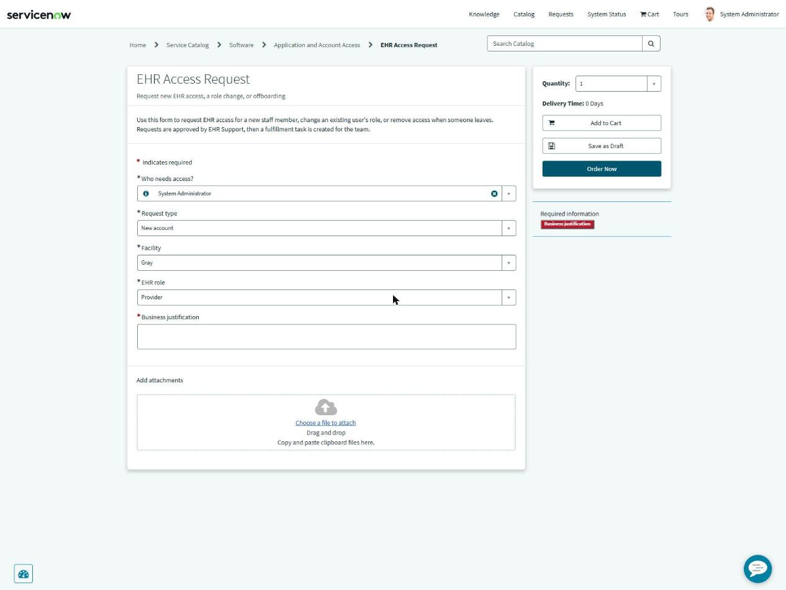
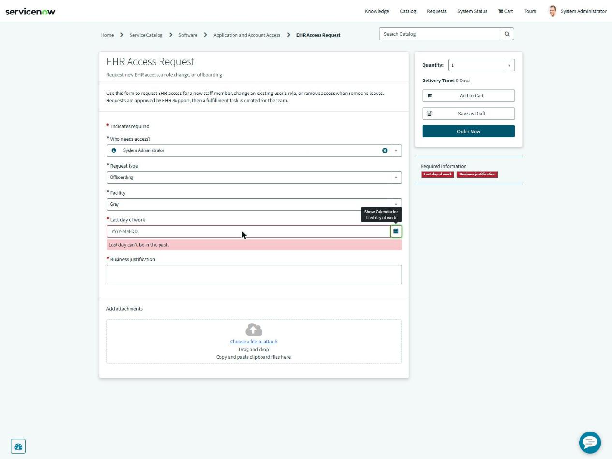
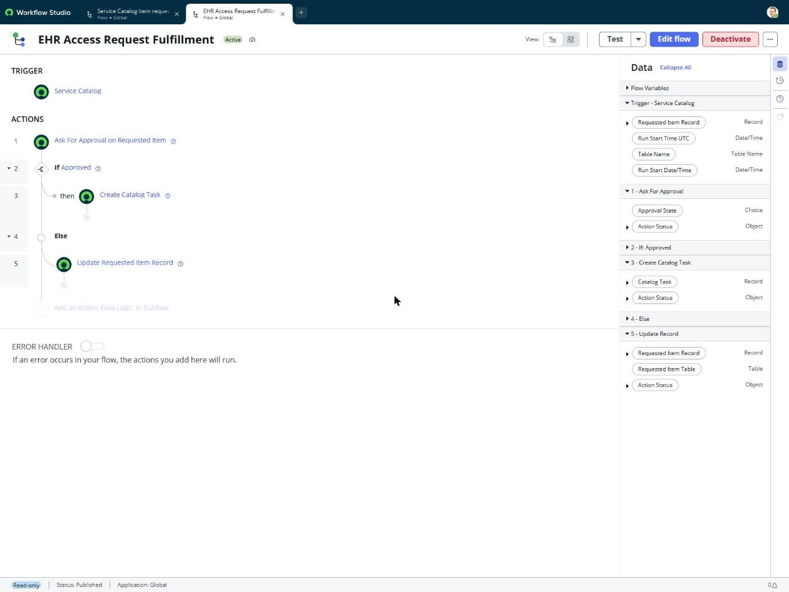
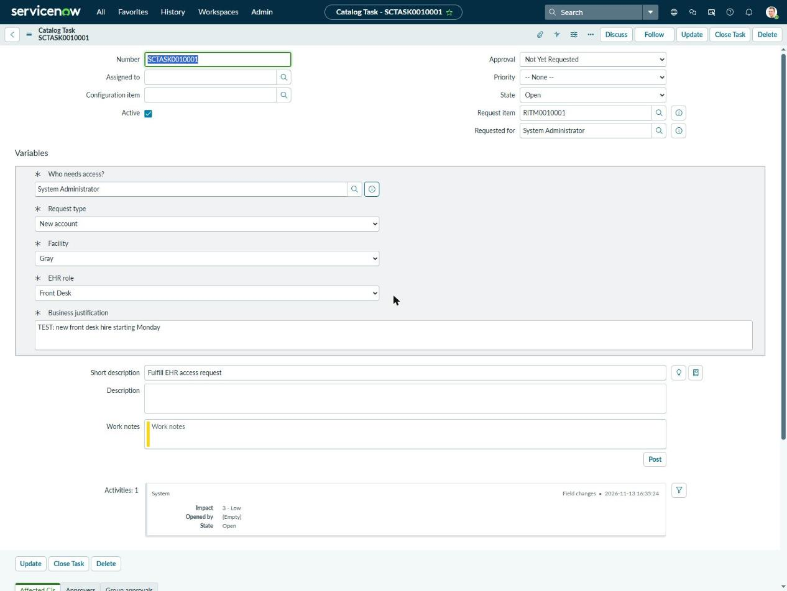
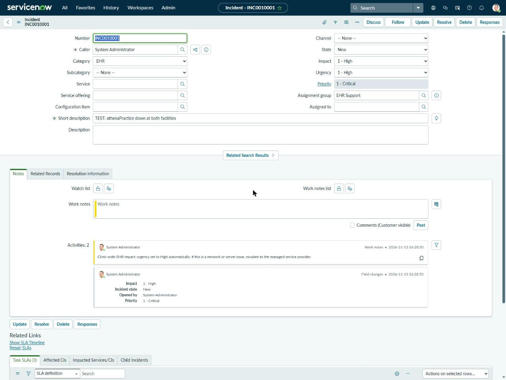
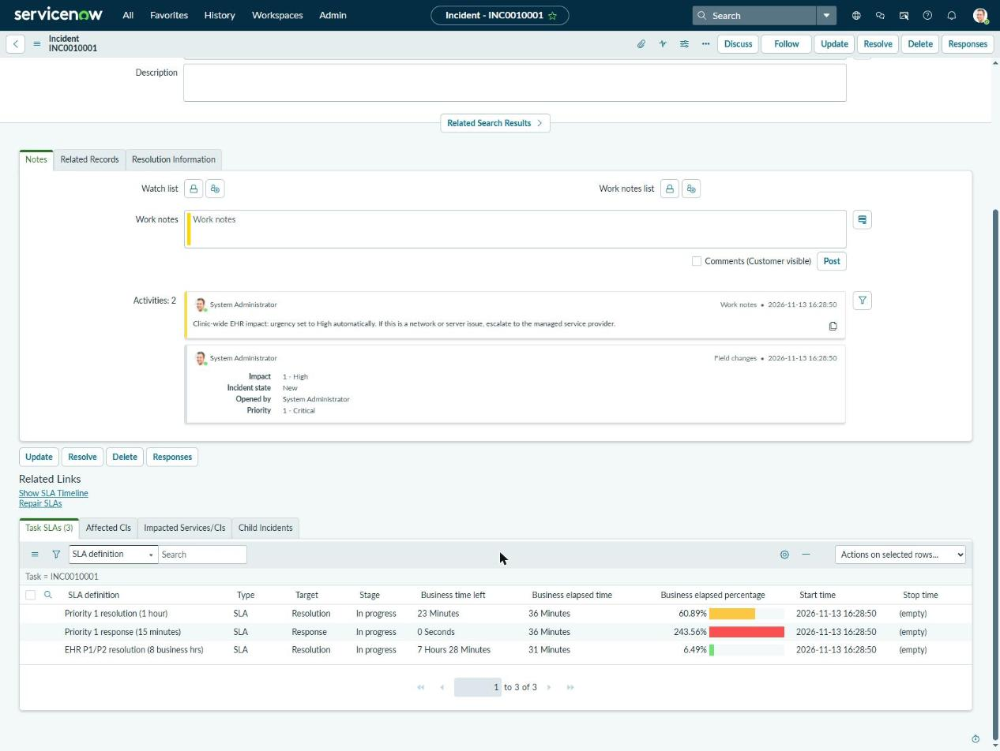

# servicenow-ehr-lab

I'm the sysadmin at a two-location neurology practice. We have about 100 users on one EHR and no ticketing system. Access requests come in by word of mouth, and outages get escalated to our IT vendor by email.

This is what I'd set up if we had ServiceNow. I built it on a free personal developer instance. All the data in it is fake.

## What's in it

**Access requests (Service Catalog + Flow Designer)**

- An *EHR Access Request* catalog item: who needs access, request type (new account, role change, offboarding), facility, EHR role, and a justification.
- A catalog UI policy. Picking *Offboarding* hides the role field and asks for a last day of work instead.
- A catalog client script that won't accept a last day in the past.
- A flow, *EHR Access Request Fulfillment*. The request goes to EHR Support for approval. If it's approved, a catalog task is created for the group with the form answers copied over. If it's rejected, the request is closed incomplete.

**Incidents**

- An *EHR* incident category.
- An assignment rule that sends EHR incidents to EHR Support.
- A before business rule. If an EHR incident is marked high impact (the whole clinic is affected), it raises urgency to high, which makes it a P1. It also leaves a work note about escalating to the vendor.
- An SLA: P1/P2 EHR incidents should be resolved within 8 business hours on an 8-5 weekday schedule. It pauses while the incident is on hold.

The two scripts are also in [`scripts/`](scripts/) if you just want to read the code.

## Screenshots

| | |
|---|---|
|  |  |
| Request form | Offboarding: role swapped for last day, past date rejected |
|  |  |
| Approval and fulfillment flow | Task created for EHR Support after approval |
|  |  |
| Test outage auto-routed and bumped to P1 | SLAs attached to the incident |

## Try it yourself

You'll need your own personal developer instance (free at developer.servicenow.com).

1. In your instance, go to **System Update Sets > Retrieved Update Sets** and click **Import Update Set from XML**.
2. Upload `update-set/ehr-itsm-lab.xml`.
3. Open the retrieved set, click **Preview Update Set**, then **Commit Update Set**.

The update set includes the EHR Support group with the default `admin` user as a member, so approvals and tasks land somewhere you can see them.

To test:

- **Request:** open the Service Portal (`/sp`), search for *EHR Access*, and submit a request. Approve it from **My Approvals** (or the RITM). A catalog task assigned to EHR Support should show up.
- **Offboarding:** set Request type to *Offboarding*. The role field disappears and Last day of work shows up. Try a date in the past.
- **Outage:** create an incident with Category *EHR* and Impact *1 - High*. It should be assigned to EHR Support, come out as P1, and have the EHR SLA attached.

## Notes

- Approval goes to the EHR Support group because the dev instance's admin account has no manager. In a real setup I'd send it to the requester's manager or the practice administrator.
- The past-date check only runs in the browser. Anything submitted through the API would skip it, so a real deployment should check it on the server side too.
- The client script assumes the default `yyyy-MM-dd` date format.
